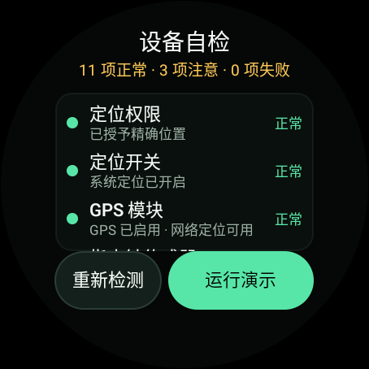
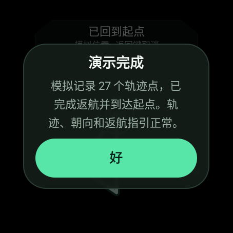
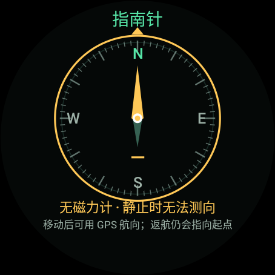
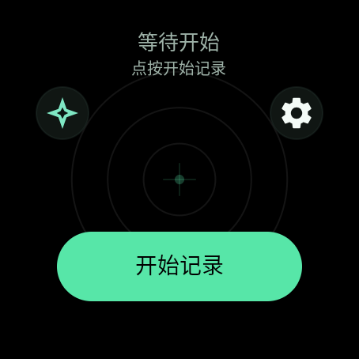

# 迷途返航 · MiTuFanHang

[](LICENSE)

一个为 **Wear OS 手表** 设计的极简轨迹记录与返航应用。界面只有黑底地图、轨迹、当前位置和返航箭头；不需要联网、不需要 Google Play 服务，所有轨迹只保存在手表本地。

优先适配 **TicWatch Pro 3 中国大陆版**（骁龙 Wear 4100 / Wear OS 2.38 / 454×454 圆屏），最低支持 **Wear OS 2（Android 7.1，API 25）**。

---

## 功能

- **记录轨迹**：点“开始记录”后，使用系统 `LocationManager` 的 GPS + 网络定位，实时绘制走过的路线。
- **防止熄屏 / 睡眠**：记录期间持有 `PARTIAL_WAKE_LOCK`；开启“屏幕常亮”时额外持有 `SCREEN_DIM_WAKE_LOCK | ACQUIRE_CAUSES_WAKEUP`，主界面设置 `FLAG_KEEP_SCREEN_ON`，但**不覆盖系统亮度**，不会把屏幕强制拉到最高亮度。可在设置中关闭。
- **朝向朝上地图**：默认地图随手表航向旋转，用户朝向永远朝屏幕上方；也可在设置改为“正北朝上”。地图纯黑填充，不绘制道路。
- **返航指引**：点“开始返航”后，地图用琥珀色虚线连接当前位置与起点，`GuideView` 在当前位置周围显示大号箭头；顶部显示距起点距离和“前方 / 左前方 / 右侧…”方向。起点在屏幕外时，地图边缘显示指向起点的箭头。
- **到达与偏航提醒**：距起点 12 m 内震动并显示“已回到起点”；明显偏离最佳返航距离时震动提醒（45 秒冷却，可关闭震动）。
- **断点恢复**：开始记录时和每 20 秒把未完成轨迹写入 `active_track.json`；应用/进程被系统杀掉后重新打开，会提示“继续记录 / 放弃”。结束记录后写入 `last_track.json`，下次打开可预览上次路线。
- **圆形 / 方形布局**：自动读取 `Configuration.isScreenRound()`，也可在设置强制圆形或方形。圆屏会裁切根布局并把按钮、齿轮收进安全区。
- **腕上设置**：表盘形状、屏幕常亮、地图朝向、震动、定位间隔（1/2/5 秒）、恢复默认、关于、测试模式、终止程序运行。
- **设备自检与演示**：设置里的“测试模式”会检查定位权限/开关/GPS、指南针与运动传感器、实际航向、震动、屏幕布局、存储、唤醒锁、通知和前台服务；随后可用假位置完整演示“开始记录 → 移动 → 开始返航 → 到达起点”，演示结果直接显示在列表中，且不会覆盖真实轨迹。

## 交互

| 状态 | 主按钮 | 次按钮 |
| --- | --- | --- |
| 未记录 | 开始记录（黑字） | 隐藏 |
| 记录中 | 开始返航（黑字） | 结束（弹确认） |
| 返航中 | 结束返航（回到普通记录） | 结束（弹确认） |

- 记录中按手表返回键只会把任务切到后台，服务继续记录；再次从应用列表/通知打开即可回到地图。
- 通知栏有“结束”动作，可在不打开应用时结束记录。
- 右上角齿轮进入设置。

## 设备自检 / 测试模式

从 **设置 → 测试模式** 打开，适合新设备到手或定位/指南针异常时排查：

- 自检项：定位权限、系统定位开关、GPS/网络 provider、指南针传感器、运动传感器、实际航向读数、震动马达、屏幕形状与分辨率、内部存储读写、`PARTIAL_WAKE_LOCK`、通知权限、前台定位服务声明、Android/API/机型。
- 结果显示为“正常 / 注意 / 失败”；“注意”通常表示设备只有部分指南针传感器、室内读不到航向或通知被关闭，不一定是故障。
- 点“运行演示”后，应用通过 `TrackingService` 的演示模式注入假位置，完整跑一遍记录、移动、返航和到达；地图、轨迹、朝向箭头都使用真实绘制代码，但**不会写入或覆盖** `active_track.json` / `last_track.json`。
- 演示结束会弹出结果（模拟轨迹点数、是否到达起点），并在自检列表的“轨迹与返航演示”一项留下同样结果。演示期间按返回键可取消。

| 自检结果 | 演示中的返航 |
| --- | --- |
|  |  |

## 兼容性

| 项目 | 值 |
| --- | --- |
| 包名 | `com.mitufanhang.wear` |
| minSdk | 25（Wear OS 2 / Android 7.1） |
| targetSdk | 30 |
| compileSdk | 36（`compileSdkMinor 1`，即 android-36.1） |
| 语言 / UI | Java + 原生 View/Canvas，无 Kotlin、无 Compose、无 AndroidX |
| 定位 | 系统 `LocationManager`，不依赖 Google Play Services |
| 权限 | `ACCESS_FINE_LOCATION`、`ACCESS_COARSE_LOCATION`、`WAKE_LOCK`、`FOREGROUND_SERVICE`、`VIBRATE` |
| 数据 | 仅应用私有目录，无网络权限 |

TicWatch Pro 3 中国大陆版没有完整的 Google 服务，因此项目刻意不引入 FusedLocationProvider / Wearable Data Layer。轨迹与设置均不离开手表。

## 构建

环境要求：

- Android Studio 2026.1 或兼容版本
- JDK 17（Android Studio 自带 JBR 即可）
- Android SDK Platform 36.1、Build-Tools 36.0.0

用 Android Studio 直接打开 `MiTuFanHang` 目录，等待 Gradle Sync 后运行 `app` 即可。项目已包含 Gradle Wrapper（Gradle 9.6.0）；调试构建优先使用仓库内 `keystore/debug.keystore`（不存在时回退到系统调试签名）。

命令行构建：

```bash
cd MiTuFanHang
./gradlew app:assembleDebug
```

如果本机环境不允许写 `~/.gradle`（例如受限沙箱），使用项目内目录：

```bash
GRADLE_USER_HOME="$PWD/.gradle-home" \
  .gradle-dist/gradle-9.6.0/bin/gradle app:assembleDebug --no-daemon
```

产物：

```
app/build/outputs/apk/debug/app-debug.apk
迷途返航-v1.2.0-debug.apk   # 同一产物的易取副本
```

运行单元测试与 lint：

```bash
./gradlew app:testDebugUnitTest app:lintDebug
```

### 构建正式签名包

仓库不包含正式签名密钥。先按 [keystore/README.md](keystore/README.md) 生成 `keystore/release.jks`，再复制 `keystore.properties.example` 为 `keystore.properties` 并填入密码：

```bash
cp keystore.properties.example keystore.properties
# 编辑 keystore.properties，填入真实密码
./gradlew app:assembleRelease
```

产物：

```
app/build/outputs/apk/release/app-release.apk
```

`keystore.properties`、`*.jks`、`*.keystore` 和 APK/AAB 都已在 `.gitignore` 中排除，不会被误提交。请离线备份正式密钥；Android 不允许用不同签名的 APK 覆盖安装。

## 安装到 TicWatch Pro 3

1. 手表打开 **设置 → 系统 → 关于**，连续点“版本号”7 次，开启开发者选项。
2. 在开发者选项中打开 **ADB 调试**。
3. 手表和电脑连同一个 Wi-Fi；在手表 **设置 → 网络/Wi-Fi** 查看 IP 地址。
4. 电脑执行：

   ```bash
   adb connect <手表IP>:5555
   adb devices
   adb install -r app/build/outputs/apk/debug/app-debug.apk
   ```

   如果 `adb` 不在 PATH 中，可用：

   ```bash
   ~/Library/Android/sdk/platform-tools/adb connect <手表IP>:5555
   ```

5. 手表应用列表中出现“迷途返航”。首次点“开始记录”时允许定位权限；然后到户外空旷处等待搜星。

> 中国大陆版 TicWatch 可能没有 Google Play 商店，直接 ADB 安装即可。若提示 `INSTALL_FAILED_UPDATE_INCOMPATIBLE`，先卸载旧版本再安装。

## 首次使用建议

1. 手表使用 **智能模式**，不要用“持久模式/省电模式”；否则系统可能限制 GPS、后台服务或熄屏。
2. 打开手表的定位服务；在户外空旷处等待 30–90 秒，顶部从“正在搜星”变为“记录中”。
3. 如果设备有磁力计，第一次使用或换环境后，拿着手表在空中画几个“8”字校准；远离磁铁、金属桌面和车内。部分 TicWatch Pro 3 中国大陆版没有磁力计，静止时无法测向，移动时使用 GPS 航向，返航仍会指向起点。
4. 需要长时间记录时，把“屏幕常亮”保持开启；它只阻止熄屏，不会强制最高亮度。如果只想记录、不看屏幕，可关闭它以省电。
5. 不需要应用时，进设置点“终止程序运行”：会停止定位、常亮锁、传感器和前台服务并退出；未完成轨迹保留，下次可继续。
6. 返航时看大箭头和顶部“距起点 + 方向”；不用一直盯着小地图。

## 指南针与 8 字校准

- 主界面左上角的星形按钮打开全屏指南针；返航时如果航向异常，图标会变为琥珀色并弹出一次校准提示。
- 有磁力计/旋转矢量的设备：读数低精度或长时间无更新时，显示“读数异常 · 请画 8 字校准”，点提示可查看校准步骤。
- 没有磁力计的设备（部分 TicWatch Pro 3 中国大陆版）：页面明确显示“无磁力计 · 静止时无法测向”；移动后使用 GPS 航向，返航箭头仍会指向起点。这是硬件限制，不是 App 故障。



## 数据与隐私

- 轨迹文件：应用私有目录 `files/active_track.json`（未完成）与 `files/last_track.json`（最近一次完成）。
- 设置：`SharedPreferences` 文件 `mitu_settings`。
- 应用没有申请 `INTERNET` 权限，不会上传任何数据；卸载应用会删除全部轨迹。

## 项目结构

```
app/src/main/java/com/mitufanhang/wear/
  MainActivity.java        主界面：地图、状态、按钮、权限、恢复/结束对话框
  SettingsActivity.java    设置界面（滚动、分段选择、开关）
  SelfTestActivity.java    设备自检 + 假位置轨迹/返航演示
  CompassActivity.java     全屏指南针 + 8 字校准提示 + GPS 航向回退
  CompassView.java         罗盘刻度、指针与读数绘制
  TrackingService.java     前台服务：定位、轨迹、航向、常亮锁、通知、返航判定、demo 注入
  TrackMapView.java        黑底地图、轨迹、起点、当前位置、北向标记
  GuideView.java           返航大箭头 / 到达对勾 / 偏航脉冲
  WatchFrameLayout.java    圆形裁切 / 方形根布局
  WatchDialog.java         小屏确认对话框
  HeadingProvider.java     旋转矢量 + 加速度计/磁力计回退，真北航向
  AppSettings.java         设置读写
  TrackSession.java        轨迹会话与折线距离
  TrackPoint.java          单个轨迹点
  TrackStore.java          AtomicFile JSON 持久化
  Geo.java                 距离、方位角、角度差、格式化
app/src/test/java/com/mitufanhang/wear/
  GeoTest.java             距离/方位/格式化测试
  TrackSessionTest.java    轨迹跳变过滤、距离累计、时长测试
```

## 验证状态

主界面真机截图（454×454）：



- `app:assembleDebug`：通过，生成可安装 debug APK；已通过 ADB 安装到连接的 TicWatch（454×454 圆屏），主界面显示正常。
- `app:testDebugUnitTest`：通过（12 个 JVM 测试：`GeoTest` 8 个、`TrackSessionTest` 4 个）。
- `app:lintDebug`：0 error、37 warning（未使用资源、绘制分配、Wear recents 等提示）。
- 测试模式已在 TicWatch Pro 3（454×454 圆屏）上跑通：自检 11 项正常、3 项注意、0 项失败；“运行演示”使用假位置走完记录、移动、返航并到达起点（27 个轨迹点），结果弹窗与列表均正常，演示未写入真实轨迹。
- 尚未做长时间 GPS、常亮耗电和返航精度实测；本机没有 Wear OS 模拟器或 AVD。建议先在户外短距离试用，确认定位与指南针表现后再依赖它走长线。

## 已知限制

- 地图是纯黑画布，只显示轨迹、起点、当前位置和方向，不显示道路、建筑或 POI（按需求刻意如此）。
- 返航是“指向起点 + 直线距离”的指南针式引导，不是沿原路逐步导航；遇到河流/围墙需要自行绕行。
- 航向优先来自手表磁力计/旋转矢量；没有磁力计时只能靠 GPS 移动方向，静止时无法测向。磁力计读数受金属、磁铁和佩戴角度影响，地图朝向可能短暂抖动。
- 屏幕常亮锁最长 8 小时，超时后系统可能重新允许熄屏；长时间记录请留意电量。
- 进程被系统杀死后，重启时从最后一个已保存点继续；断档期间走过的路不会被补画。
- 仓库不包含正式签名密钥；发布前请按 [keystore/README.md](keystore/README.md) 生成并妥善备份自己的 release keystore。

## 许可证

本项目使用 [MIT License](LICENSE) 开源。
